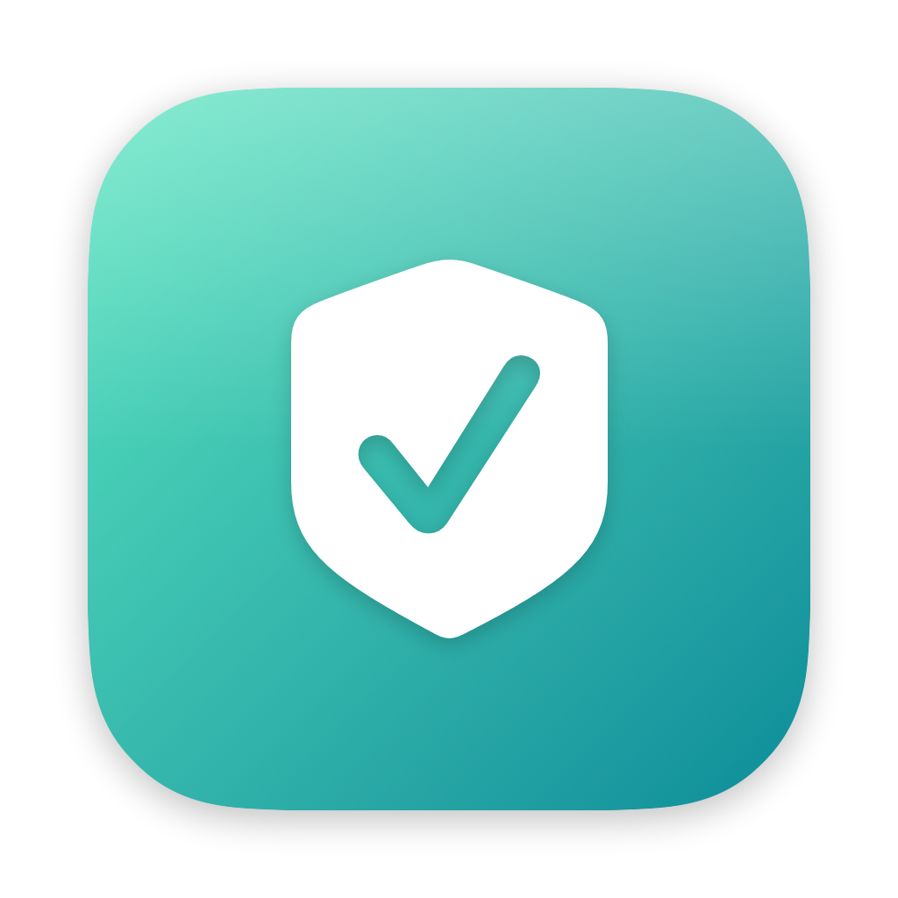
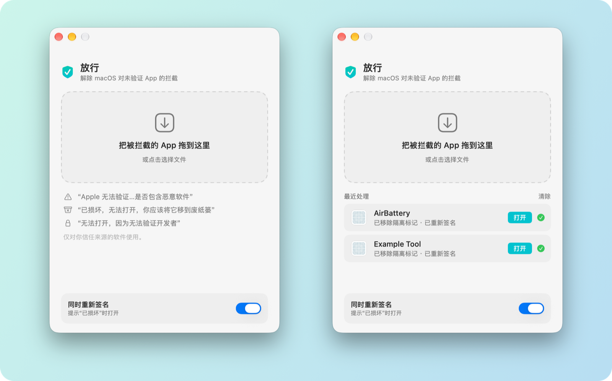

<p align="center">
  
</p>

<h1 align="center">放行 LetIn</h1>

<p align="center">
  一个轻量的 macOS 小工具：把被系统拦截的 App 拖进来，就能正常打开了。
</p>

<p align="center">
  
  
  
  
</p>

<p align="center">
  
</p>

---

## 它解决什么问题

从网上（GitHub、开发者官网、网盘等）下载的 App，第一次打开时 macOS 可能会弹出：

| 提示 | 常见原因 |
| --- | --- |
| **“Apple 无法验证 “xxx” 是否包含可能危害 Mac 安全或泄漏隐私的恶意软件”** | App 没有经过 Apple 公证 |
| **“xxx 已损坏，无法打开。你应该将它移到废纸篓”** | 签名缺失或不完整，同时带有隔离标记 |
| **“无法打开 xxx，因为无法验证开发者”** | 开发者没有 Apple 开发者证书 |

从 macOS 15 开始，原来“右键 → 打开”的绕过方法已经不能用了。每次都要去「系统设置 › 隐私与安全性」里点“仍要打开”，或者打开终端敲 `xattr` 命令。

**放行**把这件事简化成了一个动作：**拖进来，搞定。**

## 功能

- **拖放即用**：把 App 拖进窗口、拖到 Dock 图标上，或者点击后选择文件，一次可以处理多个
- **清除隔离标记**：移除系统给下载文件加上的 `com.apple.quarantine` 属性
- **可选重新签名**：遇到“已损坏”提示时，打开开关，在本地给 App 重新签名（ad-hoc）
- **自动申请权限**：修改 `/Applications` 里的 App 需要权限时，会弹出系统自带的管理员授权窗口
- **处理完直接打开**：每条记录旁边都有“打开”按钮
- **轻量原生**：用 SwiftUI 写成，全部代码只有一个文件，打包后约 2 MB；无联网、无统计、无依赖；同时支持 Apple Silicon 和 Intel

## 安装

### 直接下载

到 [Releases](https://github.com/245678000000/LetIn/releases/latest) 下载 `LetIn-x.x.x.zip`，解压后把 **放行.app** 拖到「应用程序」文件夹。

放行本身也没有经过 Apple 公证，所以**第一次打开**同样会被拦截。在终端执行一次下面的命令就好：

```sh
xattr -cr /Applications/放行.app
```

或者先双击一次，然后打开「系统设置 › 隐私与安全性」，在页面底部点击“仍要打开”。

### 从源码构建

需要 macOS 14 以上，并安装 Xcode Command Line Tools（`xcode-select --install`）。

```sh
git clone https://github.com/245678000000/LetIn.git
cd LetIn
./build.sh
cp -R "build/放行.app" /Applications/
```

在本机构建的 App 不带隔离标记，可以直接打开。

## 使用

1. 打开 **放行**
2. 把打不开的 App 拖进窗口（也可以拖到 Dock 上的放行图标）
3. 看到绿色 ✓ 后，点击 **打开**

> **提示“已损坏”？** 先打开底部的「同时重新签名」开关，再把 App 拖进来一次。

> **提示“系统拒绝修改”？** 点击“去设置”，在「隐私与安全性 › App 管理」里允许 **放行**，然后点击重试。

## 原理

放行做的事等同于在终端里执行下面的命令，只是更方便：

```sh
# 清除扩展属性（包括隔离标记）
xattr -cr /Applications/xxx.app

# 可选：本地 ad-hoc 重新签名
codesign --force --deep --sign - /Applications/xxx.app
```

遇到权限不足时，放行会通过 `osascript` 的 `with administrator privileges` 调用系统授权窗口。它不会保存你的密码，也不会常驻后台。

## 项目结构

```
LetIn/
├── Sources/main.swift   # 全部代码（界面 + 逻辑）
├── icon.swift           # 生成 App 图标
├── build.sh             # 编译、生成图标、打包 .app、签名
└── docs/screenshot.png
```

## ⚠️ 安全提醒

Gatekeeper 是 macOS 的一道重要防线。**放行**会为指定的 App 关闭这道检查，所以：

- 只用在**你信任来源**的软件上，比如官方 GitHub Releases 或开发者官网
- 不要用来打开来路不明的破解软件

## License

[MIT](LICENSE)
